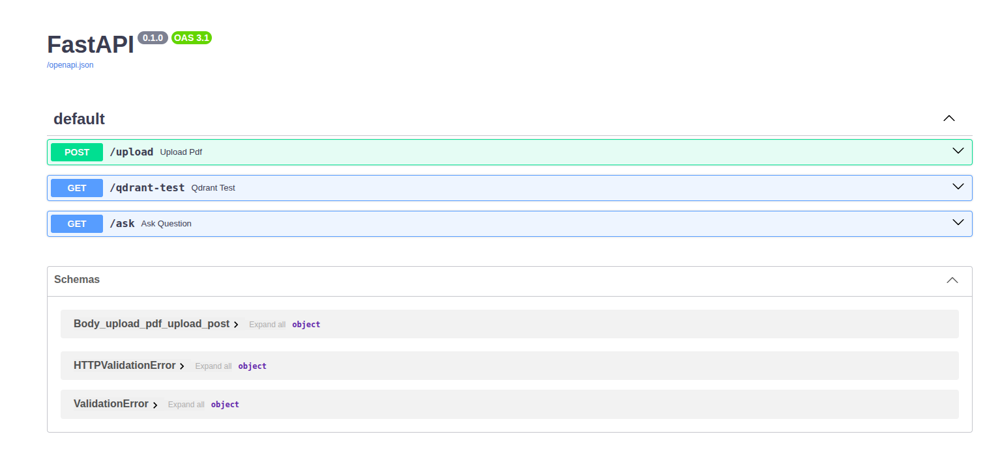
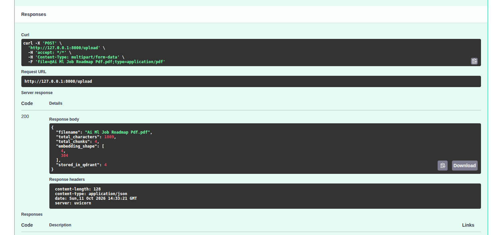

# 🤖 RAG PDF Chatbot

A Retrieval-Augmented Generation (RAG) chatbot that answers questions from PDF documents using semantic search and a Large Language Model (LLM).

## ✨ Features

- Extracts text from PDF documents.
- Splits text into smaller chunks.
- Generates embeddings using Sentence Transformers.
- Stores and retrieves relevant chunks using Qdrant Cloud.
- Generates context-based answers using Groq API.
- Provides API endpoints through FastAPI.
  
## 📸 Project Screenshots

### API Endpoints


### PDF Upload


### Question Answering


## 🛠️ Tech Stack

- Python
- FastAPI
- PyMuPDF
- Sentence Transformers
- Qdrant Cloud
- Groq API

## ⚙️ Setup

### 1. Clone the repository

```bash
git clone https://github.com/YOUR_USERNAME/RAG-PDF-Chatbot.git
cd RAG-PDF-Chatbot
```

### 2. Create a virtual environment

```bash
python3 -m venv .venv
source .venv/bin/activate
```

### 3. Install dependencies

```bash
pip install -r requirements.txt
```

### 4. Configure environment variables

Create a `.env` file in the project directory:

```env
GROQ_API_KEY=your_groq_api_key
QDRANT_URL=your_qdrant_url
QDRANT_API_KEY=your_qdrant_api_key
```

Replace the placeholders with your own credentials. Never upload your `.env` file.

### 5. Run the application

```bash
uvicorn main:app --reload
```

Open `http://127.0.0.1:8000/docs` to test the API endpoints.

## 🧠 How It Works

1. Extract text from a PDF.
2. Split the text into chunks.
3. Convert chunks into vector embeddings.
4. Store embeddings in Qdrant Cloud.
5. Retrieve relevant chunks for a question.
6. Use the retrieved context to generate an answer through Groq.

## 🚧 Future Improvements

- Support multiple PDFs.
- Add source citations and page references.
- Build a Streamlit frontend.
- Add conversation history.

## 👨‍💻 Author

GitHub: https://github.com/Dhruvkashmira
